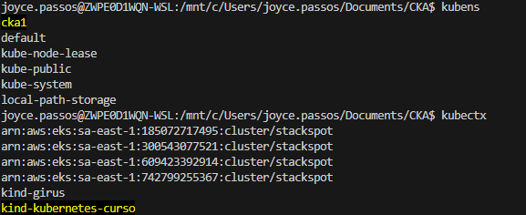
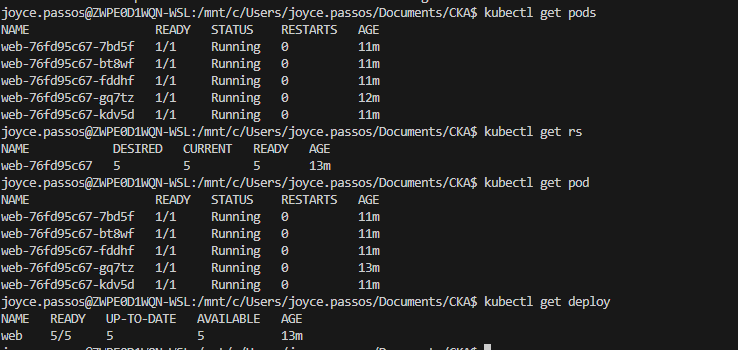
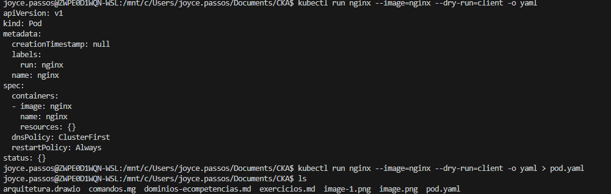
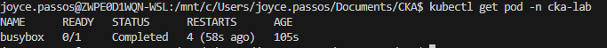
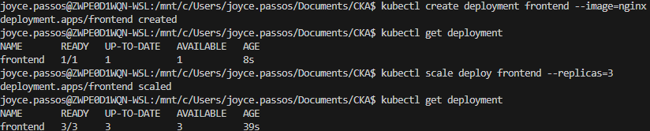
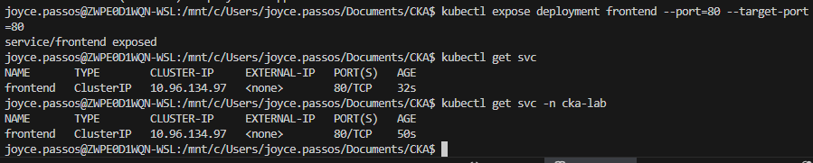
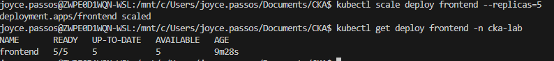
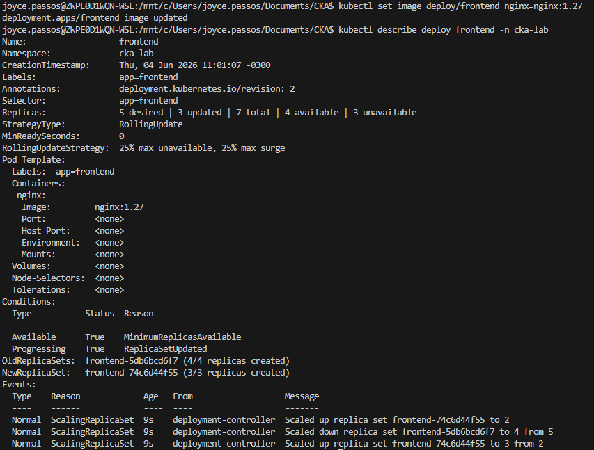

# Exercicíos  CKA 

## Exercício 1 - Criar um Pod em uma linha

Crie um pod chamado `nginx` usando a imagem `nginx:1.27`.

```bash
kubectl run nginx --image=nginx:1.27
```

Verifique:

```bash
kubectl get pod
```

---

## Exercício 2 - Criar Pod em Namespace

Crie um pod chamado `redis` no namespace `cka`.

```bash
kubectl run redis --image=redis:7 --namespace=cka
```

Se o namespace não existir:

```bash
kubectl create ns cka
```

---

## Exercício 3 - Criar Deployment em uma linha

Crie um deployment chamado `web` com imagem nginx.

```bash
kubectl create deployment web --image=nginx
```

Verifique:

```bash
kubectl get deploy
kubectl get rs
kubectl get pod
```



---

## Exercício 4 - Criar Deployment com 5 Réplicas

```bash
kubectl create deployment web --image=nginx --replicas=5
```

Se sua versão não suportar `--replicas`:

```bash
kubectl create deployment web --image=nginx
kubectl scale deploy web --replicas=5
```

---

## Exercício 5 - Gerar YAML sem aplicar

Muito comum na prova.

Gerar YAML de um Pod:

```bash
kubectl run nginx --image=nginx --dry-run=client -o yaml
```

Salvar em arquivo:

```bash
kubectl run nginx --image=nginx --dry-run=client -o yaml > pod.yaml
```

---

## Exercício 6 - Gerar YAML de Deployment

```bash
kubectl create deployment web --image=nginx --dry-run=client -o yaml > deploy.yaml
```

Aplicar:

```bash
kubectl apply -f deploy.yaml
```

---

# Exercícios estilo CKA

## Questão 1

Crie um namespace chamado:

```text
cka-lab
```

Crie um pod:

```text
Nome: busybox
Imagem: busybox:1.36
Namespace: cka-lab
```

Comando para validar:

```bash
kubectl get pod -n cka-lab
```

---

## Questão 2

Crie um deployment:

```text
Nome: frontend
Imagem: nginx
Réplicas: 3
Namespace: cka-lab
```

Validação:

```bash
kubectl get deploy,pod -n cka-lab
```


---

## Questão 3

Exponha o deployment frontend através de um ClusterIP.

```text
Service: frontend-svc
Porta: 80
TargetPort: 80
```

Validação:

```bash
kubectl get svc -n cka-lab
```



---

## Questão 4

Escalone o deployment frontend para 5 réplicas.

Validação:

```bash
kubectl get deploy frontend -n cka-lab
```



---

## Questão 5

Atualize a imagem do deployment:

```text
de nginx para nginx:1.27
```

Sem editar YAML.

Validação:

```bash
kubectl describe deploy frontend -n cka-lab
```



---

## Questão 6

Crie um ConfigMap:

```text
Nome: app-config
Chave: environment
Valor: production
```

Validação:

```bash
kubectl get cm app-config -o yaml
```

---

## Questão 7

Crie um Secret:

```text
Nome: db-secret
username=admin
password=supersecret
```

Validação:

```bash
kubectl get secret db-secret -o yaml
```

---

## Questão 8

Crie um PVC:

```text
Nome: data-pvc
Storage: 1Gi
AccessMode: ReadWriteOnce
StorageClass: local-path
```

Validação:

```bash
kubectl get pvc
```

---

## Questão 9

Crie um pod utilizando o PVC.

```text
Pod: nginx-storage
Imagem: nginx
Montar PVC em:
/usr/share/nginx/html
```

Validação:

```bash
kubectl describe pod nginx-storage
```

---

## Questão 10

Crie uma NetworkPolicy.

Permita somente pods com label:

```yaml
app: frontend
```

acessarem pods com:

```yaml
app: backend
```

Validação:

```bash
kubectl get networkpolicy
```

---

# Comandos que você deve decorar para a CKA

### Criar Pod

```bash
kubectl run nginx --image=nginx
```

### Criar Deployment

```bash
kubectl create deployment web --image=nginx
```

### Escalar

```bash
kubectl scale deploy web --replicas=5
```

### Expor Service

```bash
kubectl expose deployment web --port=80 --target-port=80
```

### Alterar Imagem

```bash
kubectl set image deploy/web nginx=nginx:1.27
```

### Gerar YAML

```bash
kubectl run nginx --image=nginx --dry-run=client -o yaml
```

### Editar recurso

```bash
kubectl edit deploy web
```

### Patch

```bash
kubectl patch deploy web -p '{"spec":{"replicas":5}}'
```

### Logs

```bash
kubectl logs POD
```

Container específico:

```bash
kubectl logs POD -c sidecar
```

### Exec

```bash
kubectl exec -it POD -- sh
```

### Eventos

```bash
kubectl describe pod POD
```

### Ver recursos

```bash
kubectl top node
kubectl top pod
```

---

### ETC commnads
export ETCDCTL_API=3
```bash
etcdctl backup
etcdctl cluster-health
etcdctl mk
etcdctl mkdir
etcdctl set
etcdctl snapshot save 
etcdctl endpoint health
etcdctl get
etcdctl put
kubectl exec etcd-master -n kube-system -- sh -c "ETCDCTL_API=3 etcdctl get / --prefix --keys-only --limit=10 --cacert /etc/kubernetes/pki/etcd/ca.crt --cert /etc/kubernetes/pki/etcd/server.crt  --key /etc/kubernetes/pki/etcd/server.key" 
```

---

1. Pods
2. Deployments
3. Services
4. ConfigMap e Secret
5. Volumes/PVC
6. NetworkPolicy
7. Ingress
8. HPA
9. Troubleshooting de Pods
10. Troubleshooting do Control Plane
11. ETCD Backup/Restore
12. Upgrade de Cluster


---

### Perguntas para Carol

1. ETCD
2. Api-server
3. Controll Manager
4. Scheduller
5. Controller Manager
6. Kubelet
7. Kubeproxy


>> https://killercoda.com/chadmcrowell/course/cka

Create a pod declaratively
List the Pods and their IP addresses
List all kubernetes services
Change deployment image
Create and Scale Apache deployment
rollback a deployment

List API Resources
Linux System Services
Kubelet status

---

>> https://killercoda.com/alexis-carbillet/course/CKA
Pod debugging
Rolling updates & rollbacks

---

>> https://killercoda.com/cka-mock-practice
Manually schedule pod and expose via NodePort

## Kube 
ps -aux | grep kube-apiserver 
ps -aux | grep kube-controller-manger
ps -aux | grep kubelel
ps -aux | grep kube-shceduler

editar as flags e como editar

sudo systemctl status kubelet
sudo systemctl status kube-apiserver 