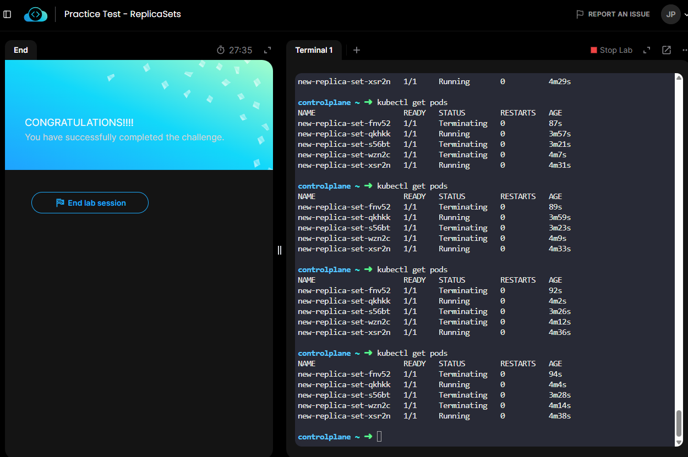
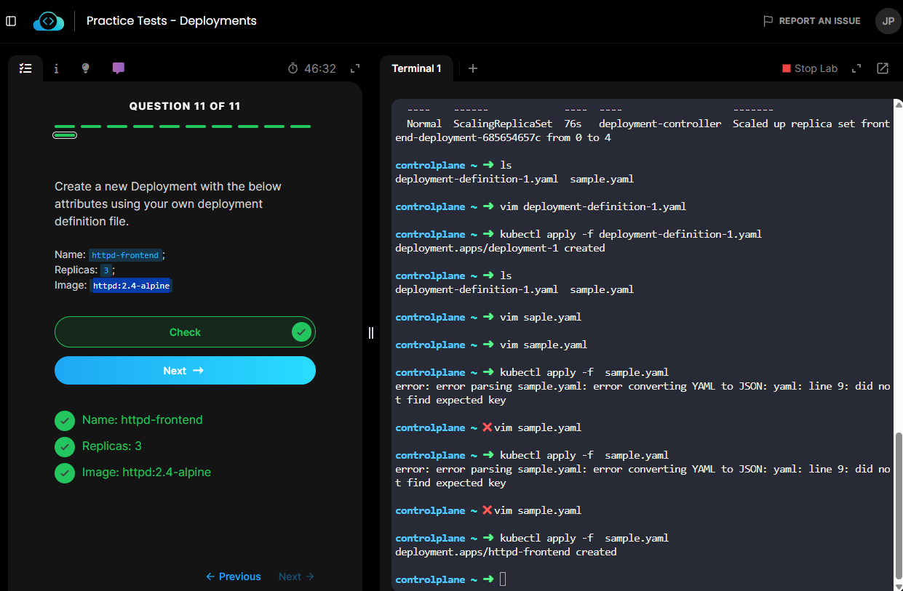
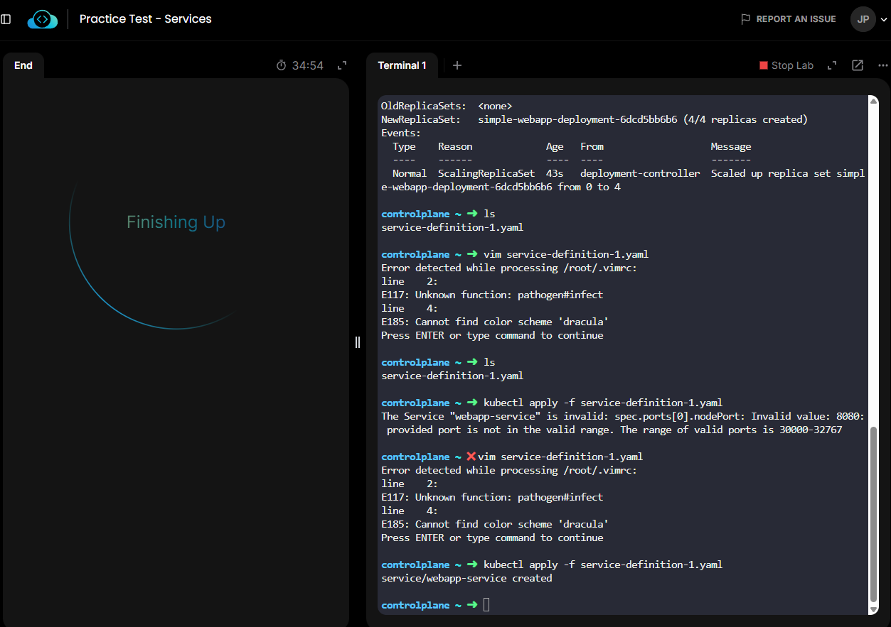
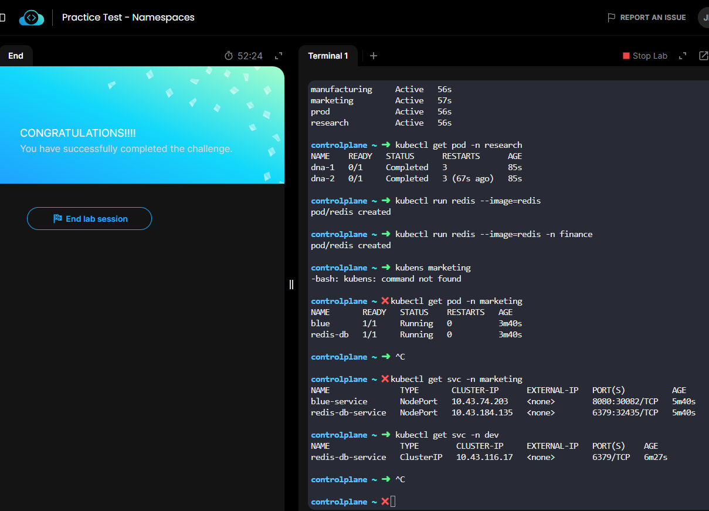
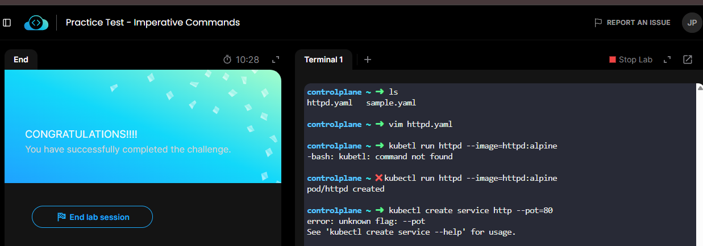

## Labs replicaset



## Labs Deployment



## Labs Services



## Labs Namespace



## Lab - Imperative Commands



## Lab Manual Scheduling

## Lab Bakup ETCD

**Sem privilégio de administrador executar o etcd e o etcdctl no seu diretório de usuário.**

1. Baixar o binário

```bash
mkdir -p $HOME/bin
cd /tmp
curl -LO https://github.com/etcd-io/etcd/releases/download/v3.6.5/etcd-v3.6.5-linux-amd64.tar.gz
```

2. Extrair

```bash
tar xzf etcd-v3.6.5-linux-amd64.tar.gz
```

3. Copiar para seu diretório

```bash
cp etcd-v3.6.5-linux-amd64/etcd $HOME/bin/
cp etcd-v3.6.5-linux-amd64/etcdctl $HOME/bin/
```

4. Adicionar ao PATH

Se usa bash:

```bash
echo 'export PATH=$HOME/bin:$PATH' >> ~/.bashrc
source ~/.bashrc
```

5. Validar

```bash
etcd --version
etcdctl version
Executar o etcd localmente
```

Crie um diretório de dados:
```bash
mkdir -p $HOME/etcd-data
```

Inicie:

```bash
etcd --data-dir=$HOME/etcd-data
```

```bash
alias k="kubectl"
k get po
K describe po <name-etcd-pod> -n kube-system 
```

```bash
      --cert-file=/etc/kubernetes/pki/etcd/server.crt
      --peer-key-file=/etc/kubernetes/pki/etcd/peer.key
      --peer-trusted-ca-file=/etc/kubernetes/pki/etcd/ca.crt
```

```bash
export ETCDCTL_API=3 etcdctl --cacert=/etc/kubernetes/pki/etcd/ca.crt --cert=/etc/kubernetes/pki/etcd/server.crt --key/etc/kubernetes/pki/etcd/peer.key snapshot save backup.bd
```