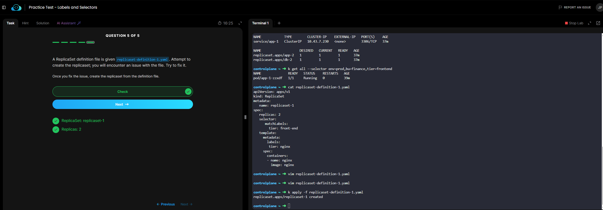
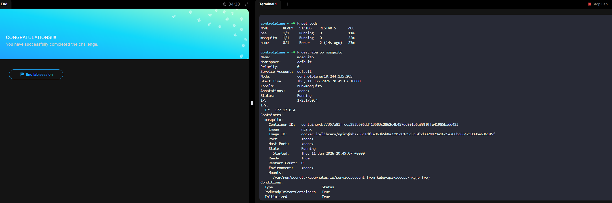

## Labs replicaset


## Labs Deployment


## Labs Services


## Labs Namespace


## Lab - Imperative Commands


## Lab Manual Scheduling

nodeName:

## Lab Bakup ETCD

**Sem privilégio de administrador executar o etcd e o etcdctl no seu diretório de usuário.**

1. Baixar o binário

```bash
mkdir -p $HOME/bin
cd /tmp
curl -LO https://github.com/etcd-io/etcd/releases/download/v3.6.5/etcd-v3.6.5-linux-amd64.tar.gz
```

2. Extrair

```bash
tar xzf etcd-v3.6.5-linux-amd64.tar.gz
```

3. Copiar para seu diretório

```bash
cp etcd-v3.6.5-linux-amd64/etcd $HOME/bin/
cp etcd-v3.6.5-linux-amd64/etcdctl $HOME/bin/
```

4. Adicionar ao PATH


```bash
echo 'export PATH=$HOME/bin:$PATH' >> ~/.bashrc
source ~/.bashrc
```

5. Validar

```bash
etcd --version
etcdctl version
```

Executar o etcd localmente

Crie um diretório de dados:

```bash
mkdir -p $HOME/etcd-data
```

Inicie:

```bash
etcd --data-dir=$HOME/etcd-data
```

```bash
alias k="kubectl"
k get po
K describe po <name-etcd-pod> -n kube-system 
```

```bash
 px ps aux | grep [e]tcd
```

```bash
ETCDCTL_API=3 etcdctl --endpoints=http://127.0.0.1:2381 --cacert=/etc/kubernetes/pki/etcd/ca.crt --cert=/etc/kubernetes/pki/apiserver-etcd-client.crt --key=/etc/kubernetes/pki/apiserver-etcd-client.key snapshot save backup.db

  ```

-----

## Lab Labels and Selectors

kubectl label node worker-01 ambiente=producao


## Labs Taints and Tolerations

Taint = "bloqueio" aplicado no node.
Toleration = "permissão" que um pod possui para ignorar esse bloqueio
Um Taint é aplicado em um node para impedir que pods sejam agendados nele

```bash
 kubectl taint nodes worker-01 ambiente=producao:NoSchedule
 kubectl describe node worker-01 | grep Taints
```

A Toleration é configurada no Pod para permitir que ele execute em um node que possui determinado taint.

```yaml
apiVersion: v1
kind: Pod
metadata:
  name: nginx
spec:
  tolerations:
  - key: "ambiente"
    operator: "Equal"
    value: "producao"
    effect: "NoSchedule"

  containers:
  - name: nginx
    image: nginx
```

Node possui Taint
↓
Pod sem Toleration
↓
Não agenda


## Labs Node Afinity
Equivalente avançado do nodeSelector.

```yaml
apiVersion: v1
kind: Pod
metadata:
  name: nginx
spec:
  affinity:
    nodeAffinity:
      requiredDuringSchedulingIgnoredDuringExecution:
        nodeSelectorTerms:
        - matchExpressions:
          - key: ambiente
            operator: In
            values:
            - producao

  containers:
  - name: nginx
    image: nginx
```

## Labs DaemonSet 
Uma réplica por node.
Novos nodes recebem o Pod automaticamente.
Muito usado para observabilidade, segurança, rede e coleta de log.
Basicamente mudar de deployment para DaemonSet

```bash
k get ds
kubectl create demoyment --help
k edit deployment 
salve new arquivo salve DaemonSet
```

## Pods Estáticos

Tipo pods criados dentro do contolplane

## Lab Priority Classes
recurso do Kubernetes usado para definir a prioridade de agendamento e de expulsão (eviction) dos Pods.

Quando não há recursos suficientes no cluster, Pods com prioridade maior têm preferência para:

Serem agendados primeiro.
Permanecerem executando.
Preemptarem (removerem) Pods de prioridade menor.
PriorityClasses padrão do Kubernetes

O Kubernetes possui algumas classes críticas internas:

system-node-critical
system-cluster-critical

```yaml
apiVersion: scheduling.k8s.io/v1
kind: PriorityClass
metadata:
  name: high-priority
value: 100000
globalDefault: false
description: "High priority workloads"
---
# ou em um pod
apiVersion: v1
kind: Pod
metadata:
  name: nginx
spec:
  priorityClassName: high-priority
  containers:
  - name: nginx
    image: nginx
```

```bash
kubectl get priorityclass
kubectl describe priorityclass high-priority
kubectl create priorityclass high-priority \
  --value=100000 \
  --description="High priority workloads"
 kubectl get pods -o custom-columns="NAME:.metadata.name,PRIORITY:.spec.priorityClassName"
```

Criar uma PriorityClass chamada high-priority com valor 1000000 e usá-la em um Pod.

```yaml
apiVersion: scheduling.k8s.io/v1
kind: PriorityClass
metadata:
  name: high-priority
value: 100000
preemptionPolicy: PreemptLowerPriority
globalDefault: false
description: "High priority class"
---
apiVersion: v1
kind: Pod
metadata:
  name: nginx
spec:
  priorityClassName: high-priority
  containers:
  - name: nginx
    image: nginx
```

## LAb Multiple Schedulers

```bash
kubectl get clusterrolebinding
kubectl get serviceaccount -n kube-system
```

## Shedules Profiles
**References**
https://github.com/kubernetes/community/blob/master/contributors/devel/sig-scheduling/scheduling_code_hierarchy_overview.md

https://kubernetes.io/blog/2017/03/advanced-scheduling-in-kubernetes/

https://jvns.ca/blog/2017/07/27/how-does-the-kubernetes-scheduler-work/

https://stackoverflow.com/questions/28857993/how-does-kubernetes-scheduler-work

## Admission Controllers

**Built-in Admission Controllers**

habilitar/desabilitar plugins no kube-apiserver

NodeRestriction
NamespaceLifecycle
PodSecurity
ImagePolicyWebhook
ServiceAccount

```bash
ps -ef | grep kube-apiserver
cat /etc/kubernetes/manifests/kube-apiserver.yaml
```

**ImagePolicyWebhook**
Configurar AdmissionConfiguration
Configurar kubeconfig
Adicionar ImagePolicyWebhook em --enable-admission-plugins
Apontar --admission-control-config-file
Entender defaultAllow ( true o webhook fica indisponivel)

Configs yaml
admission-configuration.yaml
imagepolicy-conf.yaml
kubeconf.yaml

Flags
--enable-admission-plugins=ImagePolicyWebhook
--admission-control-config-file=<file>

Endpoint
server: https://webhook-service:1323/image_policy

**ValidatingAdmissionWebhook**

Impedir Pods privilegiados. Exigir labels. Bloquear imagens não aprovadas

```yaml
apiVersion: admissionregistration.k8s.io/v1
kind: ValidatingWebhookConfiguration
```

**MutatingAdmissionWebhook**

Modifica o objeto antes de ser persistido.

```yaml
kind: MutatingWebhookConfiguration
```
Request
   |
MutatingWebhook
   |
ValidatingWebhook
   |
etcd

**Kyverno**

```yaml
apiVersion: kyverno.io/v1
kind: ClusterPolicy
## Bloquear
securityContext:
  privileged: true
## Exigir
runAsNonRoot: true
```

**OPA Gatekeeper**

```yaml
## Objetos
ConstraintTemplate
Constraint
kind: K8sRequiredLabels
```

Ordens importantes

Authentication
      ↓
Authorization
      ↓
Mutating Admission
      ↓
Validating Admission
      ↓
etcd

Comando importantes

```bash
ps -ef | grep kube-apiserver
```

| Tecnologia         | O que é                                       |
| ------------------ | --------------------------------------------- |
| ImagePolicyWebhook | Admission Controller nativo do Kubernetes     |
| Webhook            | Endpoint HTTP consultado pelo kube-apiserver  |
| ValidatingWebhook  | Apenas valida                                 |
| MutatingWebhook    | Modifica recursos                             |
| Kyverno            | Engine de políticas baseada em webhooks       |
| OPA Gatekeeper     | Outra engine de políticas baseada em webhooks |


## Validating e Mutating Admission Controller

Sim → Mutating
Não, apenas verifica → Validating

| Admission Controller     | Tipo                  |
| ------------------------ | --------------------- |
| NamespaceAutoProvision   | Mutating              |
| NamespaceExists          | Validating            |
| DefaultStorageClass      | Mutating              |
| DefaultTolerationSeconds | Mutating              |
| LimitRanger              | Mutating + Validating |
| ResourceQuota            | Validating            |
| ImagePolicyWebhook       | Validating            |
| PodSecurity              | Validating            |

```bash
k create secret tls webhook-server-tls --cert=/root/keys/webhook-server-tls.crt --key=/root/keys/webhook-server-tls.key -n webhook-demo
```

## comandos CKA

Salvar arquivos 

```bash
--raw -ojsonpath="{contexts[*].value}
helm repo list
helm search repo 
helm -n cert-manager install <service> <name-helm> --set crds.<valueenabled>=<true/false>
```

k top --containers ## Verificar mémoria limites 
-c
k explain contexto.subcontext | grep desejado
k logs -c 


# mark the node01 unschedulable
kubectl cordon node01 -- nenhum pode vai rodar no node

# list the nodes to verify that node01 is unschedulable
kubectl get no

# evict the pods that are running on node01
kubectl drain node01 --ignore-daemonsets -- expulsar todos os nos do pod

# verify that there are no pods running on node01
kubectl get po -o wide | grep node01

# mark the node scheduleable once again
kubectl uncordon node01 -- desabilitar cordon
